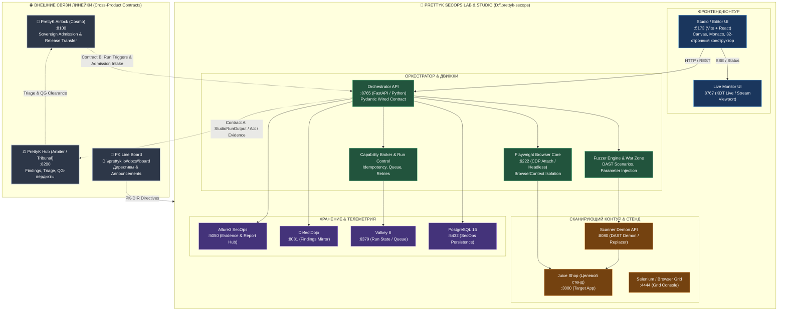

# PrettyK SecOps — Архитектурная карта системы (MAP)

> Архитектурный каркас PrettyK SecOps Studio / Lab.  
> Внутренние компоненты, рантайм-порты и внешние интерфейсы сопряжения.  
> Навигация по файлам: [`docs/INDEX.md`](INDEX.md). Операторский роутер: [`AGENTS.md`](../AGENTS.md).

---

## 1. Топология подсистем и внешних сопряжений

---

## 2. Канонические сетевые порты

Проверка портов выполняется строго через `netstat -ano | findstr :PORT` (не `Get-NetTCPConnection`).  
Канонический первоисточник: [`sanctuary/pure/stand-port-meta.md`](../sanctuary/pure/stand-port-meta.md).

| Порт | Сервис / Назначение | Протокол / Роль |
|---|---|---|
| `:5173` | Editor & Studio UI (Vite dev) | HTTP / React фронтенд |
| `:8765` | Orchestrator Engine / Playground API | HTTP / FastAPI бэкенд |
| `:8767` | Live Streaming Server (KDT Live) | HTTP + SSE стриминг выполнения |
| `:8080` | Scanner Demon API | HTTP REST DAST-движок |
| `:9222` | Chrome DevTools Protocol (CDP) | WebSocket / CDP attach к системному Chrome |
| `:5050` | Allure3 SecOps | HTTP / UI отчетов и свидетельств |
| `:8081` | DefectDojo | HTTP / Triage уязвимостей |
| `:6379` | Valkey 8 | Кеш очередей, idempotency keys, стейт |
| `:5432` | PostgreSQL 16 | Персистентная база прогонов и истории |

---

## 3. Межпродуктовые границы и сквозной handoff

Связь между продуктами линейки PrettyK осуществляется **исключительно через внешние контракты** (JSON / REST / SSE / SARIF / Webhook). Прямые импорты кода и общие базы данных между репозиториями **запрещены**.

### Сквозной Handoff линейки: Коробка → Hub → Airlock

1. **Коробка (PrettyK SecOps, PO Keeper):**
   - Проводит DAST, Fuzzing и Playwright сценарии атак.
   - Формирует факты исполнения: вердикт прогона, ГОСТ/Exception Act, ссылки на Evidence (логи, скриншоты, HAR), comparability-кортеж.
   - Передаёт структурированный `StudioRunOutput` в Hub по **Contract A** (`PK-C-009`).
   - *Инвариант:* Исполнитель не судья; коробка фиксирует наблюдаемые факты исполнения, но не выносит межпроектный допуск.

2. **Hub (PrettyK Hub, PO Arbiter):**
   - Принимает findings и evidence из коробки (Contract A Intake).
   - Выполняет дедупликацию, триаж, сопоставление с baseline и historical trends.
   - Является единственным судом (Tribunal) и источником истины (SoT) по статусу уязвимостей, override-согласованиям и вынесению вердикта Quality Gate (clearance).

3. **Airlock (PrettyK Airlock, PO Cosmo — бывший Control Plane / Cosmoport):**
   - Суверенная система допуска и межзонной передачи релизов.
   - Инициирует задачи проверок в коробке по **Contract B** (Run Triggers & Parameters).
   - Потребляет финальный security clearance из PrettyK Hub.
   - Управляет суверенным шлюзом допуска: без зелёного вердикта из Hub межзонная передача релиза заблокирована.

4. **Line Governance (Nexus → SecOps):**
   - Доска директив и объявлений линейки: `D:\prettyk.io\docs\board\ANNOUNCEMENTS.md`.
