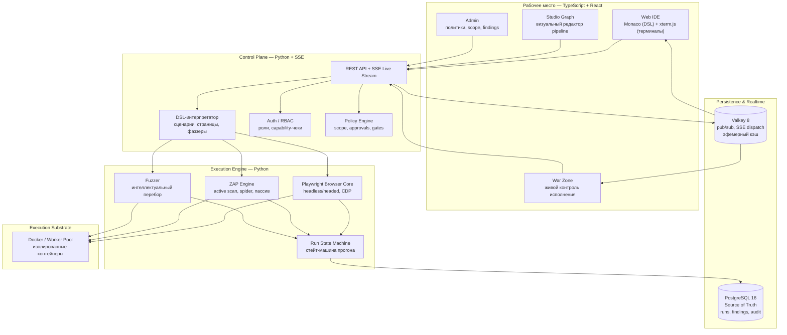

# PrettyK — брифинг для инженера (Юра)

> Это не вакансия, не презентация для инвесторов и не приглашение «бросай всё». Это честная карта того, что уже построено и куда движемся. Чтобы тебе не пришлось гуглить DAST перед встречей — вот вся суть на одном листе.

---

## Что такое PrettyK

**PrettyK — инженерная платформа для тестирования безопасности (DAST) и автоматизации браузерно-API сценариев.**

Мы не «ещё один враппер вокруг OWASP ZAP». Мы построили собственный DSL, браузерный движок на Playwright, сценарный интерпретатор, среду исполнения с изоляцией и систему сбора доказательств. Поверх этого — Web IDE, графовый редактор pipeline и живой оперативный центр управления прогонами.

Коротко: **мы даём инженеру инструмент, в котором он описывает сценарий на человекочитаемом DSL → система запускает его в изолированных воркерах → собирает findings, evidence и честные quality gates.**

Главные профили:
- **SecOps-инженер** — проверяет безопасность приложений (DAST, фаззинг, active scan, browser discovery).
- **QA/Automation-инженер** — автоматизирует рутину, E2E, браузерные сценарии без привязки к security.

---

## Архитектура одним взглядом

**Смысл:** оператор описывает сценарий в Web IDE (на DSL или визуально в графе). Контрольная плоскость проверяет права и scope. Execution Engine запускает изолированные воркеры с браузером/ZAP/фаззером. Результаты живут в PostgreSQL, живой статус летит через Valkey → SSE в интерфейс.

---

## Технический стек (4 слоя)

| Слой | Что внутри |
|---|---|
| **Engine & Runtime** | Python — DSL-интерпретатор, оркестрация прогонов. Playwright (CDP) + ZAP API — браузерная автоматизация и active/passive scan. Собственный фаззер |
| **State** | PostgreSQL 16 — durable Source of Truth. Valkey 8 — pub/sub + SSE dispatch (не источник истины, потеря переживается) |
| **Workbench** | TypeScript + React — Web IDE, Studio Graph, War Zone. Monaco Editor (LSP под наш DSL) + xterm.js |
| **Infra** | Docker Compose для локального стенда. Worker Pool с изоляцией ресурсов |

---

## Что уже летает (живое демо за 5 минут)

- Web IDE с редактором кода (Monaco) и автодополнением DSL.
- Формирование сценариев и manifest.
- Запуск прогона на Juice Shop: браузер открывает страницы, ZAP делает active scan, фаззер перебирает параметры.
- Live-мониторинг: шаги, логи, request/response в реальном времени.
- Findings с evidence: скриншоты, HAR, видео, диффы.
- Allure-отчёт, DefectDojo-синхронизация.
- Стенд со всей инфраструктурой поднимается одной командой.

Объём кода: ~120 тысяч строк (бэкенд + фронтенд, без тестов). Пишется в основном AI-агентами (DeepSeek + Gemini Flash), проектирование и архитектурные решения — за человеком.

---

## Где интересно сильному бэкендеру

- **Run State Machine** — надёжная стейт-машина прогона: pending → queued → running → succeeded/failed/cancelled. Идемпотентность, retry, таймауты, lease, переживание падения воркера.
- **Worker Pool и изоляция** — параллельный запуск браузеров/ZAP/фаззеров с контролем ресурсов, concurrency quotas, graceful shutdown.
- **PostgreSQL как Source of Truth** — схема данных, миграции, честный транзакционный outbox (чтобы события не терялись при падении Valkey).
- **Интеграции** — адаптеры к внешним CI/CD и сканерам, единый API-контракт, correlation id.
- **Automation Lab** — тот же мощный execution engine, но в режиме чистой автоматизации (E2E, RPA) без security-нагрузки.

Нулевое требование: **не надо изучать OWASP, CWE, CVSS и стандарты безопасности.** Это всё уже внутри продукта. Нужен взгляд на архитектуру, стейт-машины, надёжность исполнения и API-контракты.

---

## Формат разговора

Краткое живое демо (10 минут), потом — инженерный диалог. Без слайдов, без «продажи», без ожидания немедленного ответа.

Максим покажет, что уже работает. Дальше — просто честный разговор двух инженеров: где система сильна, где ещё сырая, куда интересно копать.

---

## Статус проекта

- Стадия: активная разработка, есть работающий стенд с полным циклом.
- Команда сейчас: 1 разработчик (Максим) + AI-агенты (DeepSeek, Gemini) + 1 дизайнер (Вера).
- Цель диалога: не хантинг, а поиск единомышленника для совместной работы над интересной инженерной системой.