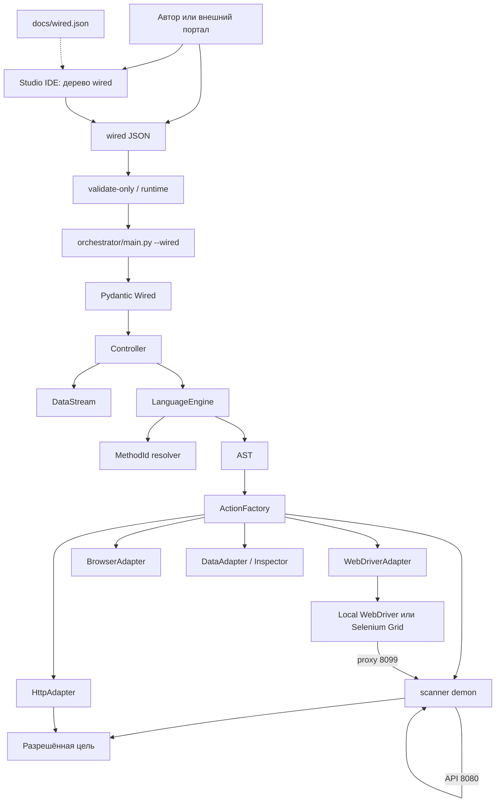
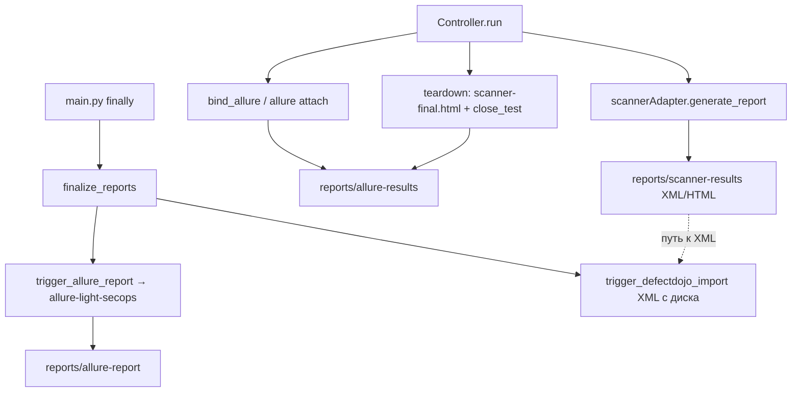
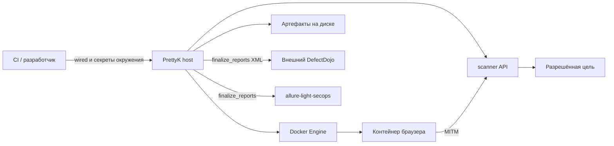

# PrettyK: технический паспорт

> **Operational detail**, не hub CANON. Истина: [`../sanctuary/pure/INDEX.md`](../sanctuary/pure/INDEX.md) · DSL: [`manifest.md`](manifest.md) · runtime-канон: [`../sanctuary/pure/runtime-shell.md`](../sanctuary/pure/runtime-shell.md).

PrettyK — SecOps-среда исполнения динамических проверок безопасности веб-приложений. Автор описывает проверку декларативно в **wired** (JSON-документ с параметрами и сценариями), runtime исполняет её через Playwright/Selenium и OWASP scanner, пишет evidence на диск и отдаёт код выхода для CI.

> [!WARNING]
> PrettyK выполняет активные действия и может изменять состояние цели. Применение допускается только в согласованном контуре и в пределах выданного разрешения на проверку.

## 1. Контур исполнения

Текущий контур:

```text
wired (JSON)
  → Python-оркестратор (Controller)
  → браузер через MITM-прокси scanner demon
  → действия spider / active scan + scanner XML/HTML на диск
  → quality gate по настраиваемому порогу серьёзности
  → main: finalize_reports
       → allure-light-secops generate
       → опциональный импорт XML в DefectDojo
```

Для заведомо уязвимой цели ожидается код процесса `2`, если сценарий завершился без ошибки, обязательные отчёты доступны и quality gate по заданному порогу не пройден.

Точка запуска:

```powershell
python orchestrator\main.py --wired <path-to-wired.json>
```

Проверка без запуска Controller, scanner и WebDriver:

```powershell
python orchestrator\main.py --wired <path-to-wired.json> --validate-only
```

## 2. Задача продукта

PrettyK отделяет описание проверки от технической обвязки конкретного пайплайна. Автор задаёт проверку декларативно, а runtime:

1. в `--validate-only` прогоняет wired через `wired_validate` (структура, конструкторы, секреты); полный run при загрузке применяет Pydantic-модель `Wired`;
2. подготавливает scanner demon, WebDriver и аутентификацию HTTP;
3. строит поток данных сценария;
4. разрешает pretty-команды и MethodId в wire-действия;
5. исполняет шаги через адаптеры;
6. завершает браузерную сессию и формирует артефакты;
7. оценивает alerts scanner по настраиваемому порогу и возвращает код для CI.

Основные потребители — разработчики PrettyK, инженеры автоматизации, AppSec и интеграторы DevSecOps.

## 3. Нецели текущего этапа

В текущий контракт не входят:

- промышленный портал управления проверками (это PrettyK Control Plane, отдельный продукт);
- защищённая конфигурация scanner, DefectDojo и браузерной фермы;
- полностью автономный airgap-дистрибутив;
- автоматическое исполнение каждого поля схемы;
- стабильный Python SDK;
- промышленная браузерная ферма сверх лабораторного Selenium Grid;
- гарантированная оркестрация зависимостей между сценариями и шагами.

Editor (`frontend/`) — рабочая среда автора: Studio-дерево (Модели данных, Сценарии, Модули, Fuzzers, Ресурсы), PrettyK-редактор, WireK как трансформ-view. Модуль `form/` — поля интеграции с порталом (CosmoLadder), не отдельная «форма запуска».

## 4. Архитектура

Два контура: **исполнение** (wired → адаптеры → цель) и **финализация отчётов** (`main` → `finalize_reports`). scanner demon пишет файлы отчётов на диск; в DefectDojo их отправляет оркестратор, не scanner.

### 4.1 Исполнение



### 4.2 Отчёты и свидетельства



Allure HTML и импорт DefectDojo вызываются только из `finalize_reports` после `Controller.shutdown`. По умолчанию сбой Allure/Dojo журналируется. При `PK_REQUIRE_ALLURE=1` или `PK_REQUIRE_DEFECTDOJO=1` отсутствие или сбой соответствующего результата переводит процесс в код `1`.

### 4.3 Компоненты

| Компонент | Ответственность |
|---|---|
| `docs/wired.json` | JSON Schema для автодополнения и структурной проверки; **machine-контракт — Pydantic `orchestrator/models/wired.py`** |
| `orchestrator/core/wired_validate.py` | `--validate-only`: полный прогон проверки wired без старта инфраструктуры |
| `orchestrator/models/wired.py` | runtime-модель: загрузка, валидация, `strip_legacy_wired_dict` |
| `orchestrator/core/controller.py` | lifecycle прогона, сценарии, данные, quality gate, запись allure-results |
| `orchestrator/core/language_engine.py` | разбор pretty-языка и построение AST |
| `orchestrator/core/method_id.py` | отображение русских MethodId в wire-действия |
| `orchestrator/core/execution_trace.py` | независимое дерево исполненных действий и control-flow для Live/Allure |
| `orchestrator/core/action_factory.py` | регистрация и вызов действий |
| `orchestrator/core/gate_policy.py` | порог gate, fail-closed поведение, `PK_*` переменные |
| `orchestrator/adapters/` | границы интеграции с WebDriver, scanner, HTTP и данными |
| `orchestrator/adapters/scanner_adapter.py` | API scanner; `generate_report` пишет файл на диск |
| `orchestrator/utils/reporter.py` | вложения; `finalize_reports` → allure-light-secops и DefectDojo; `run_summary.json` |
| `orchestrator/adapters/defectdojo_client.py` | HTTP import-scan XML (вызов из Reporter) |
| `orchestrator/utils/live_server.py` | Live-монитор (`PK_LIVE`, порт 8767) |
| `frontend/` | Studio-IDE + Explorer + Results + Admin; `form/` — CosmoLadder для портала |

Controller не должен обращаться к Selenium или scanner в обход адаптеров. Reporter — утилита финализации, не адаптер исполнения шагов.

### 4.4 Потоки управления и трафика

Управляющий поток к scanner идёт через API на `127.0.0.1:8080`. Браузерный HTTP/S-трафик направляется через отдельный listener на порту `8099`. Для удалённого браузера loopback заменяется на адрес хоста, доступный из контейнера.

Прямые запросы `HttpAdapter` не проходят через браузер. Их аутентификация подготавливается отдельно по `security_configuration.auth_*`.

## 5. Жизненный цикл прогона

Перед полным прогоном доступна отдельная ветка `--validate-only`: JSON → stripping legacy-ключей → `wired_validate` (структура, конструкторы, секреты). Она возвращает `0` или `1` и не создаёт Controller, scanner или WebDriver.

Полный прогон:

1. `main.py` загружает wired через `load_wired`: `prepare_wired_data` (env/secretref) → `strip_legacy_wired_dict` → `Wired.model_validate`.
2. `Controller` подключает scannerAdapter, создаёт listener браузерного прокси и регистрирует действия.
3. Создаётся WebDriverAdapter; реальный браузер стартует при первом браузерном действии.
4. Применяются тайм-ауты инфраструктуры и поддерживаемый HTTP auth bootstrap.
5. Для каждого сценария: `bind_allure`, Allure test result и сценарный `DataStream`.
6. Контекст и экспорт поддерживаемых data-модулей поступают в поток данных.
7. Шаг разбирается в AST или wire и исполняется через ActionFactory.
8. `save_as`, retry, failsafe и `continue_on_failure` применяются к листовым шагам; keyword `scanner Отчёт` пишет XML/HTML на диск.
9. После сценария: финальный `scanner-final.html`, закрытие Allure test; затем Controller запрашивает alerts от `PK_GATE_SEVERITY` и выше.
10. В `main` `finally`: `Controller.shutdown` (WebDriver), затем `finalize_reports` — генерация allure-light-secops и при включённой интеграции импорт XML в DefectDojo; `write_run_summary_from_controller` пишет `run_summary.json`.

Ошибки финализации отчётности журналируются отдельно. Они не подменяют результат исполнения по умолчанию, но становятся ошибкой процесса при `PK_REQUIRE_ALLURE=1` или `PK_REQUIRE_DEFECTDOJO=1`.

Приёмка — в [`../sanctuary/acceptance/`](../sanctuary/acceptance/).

## 6. Фактический контракт wired

JSON Schema описывает поверхность шире, чем runtime. Наличие поля в схеме означает, что его можно представить и проверить структурно, но не означает автоматического исполнения.

Поверхности и ворота (поля — [`manifest.md`](manifest.md)):

| Поверхность | Что делает | Что не делает |
|---|---|---|
| **Studio IDE** | авторинг wired: 5 разделов дерева, PrettyK-редактор, WireK = трансформ-view, «Валидировать» | Validate = client-side ≠ run |
| **CLI** `main.py --wired` | единственное ребро исполнения → Controller / gate / reports | UI не вызывает Controller напрямую |

### 6.1 Поддерживается

| Область | Поведение |
|---|---|
| `meta.assessment_purpose` | метка Allure и ветвление обязательности security |
| `meta.project_id` | метаданные прогона и сессии браузера |
| `infrastructure.scanner_mode` | `demon` — боевой режим; legacy webswing — только lab baseline |
| `infrastructure.browser_type` | выбор Chrome/Firefox и headless |
| тайм-ауты infrastructure | таймер работы и таймер бездействия |
| `additional_local_server_port` | дополнительный listener scanner |
| `test_suites.pages` | `constructor` макета → elements/actions; legacy массивы мержатся |
| `test_suites.imports` | `data_file` `.txt` → список строк в DataStream |
| `test_suites.scenarios[].steps` | последовательное исполнение |
| `constructor` шага | pretty, MethodId или wire |
| `retry`, `retry_delay` | повтор шага после ошибки |
| `failsafe`, `continue_on_failure` | регулируемое продолжение; scenario failsafe `<!>` |
| `save_as` | сохранение результата в DataStream |
| quality gate | код `2`, если gate включён и есть alert от `PK_GATE_SEVERITY` и выше |

### 6.2 Поддерживается частично

| Область | Ограничение |
|---|---|
| `auth_type`, `auth_details` | Basic, Bearer, API Cookie и Cookie подготавливают HttpAdapter; браузерная сессия и SSO задаются шагами |
| `test_data_constructor` | в DataStream экспортируются только реализованные формы данных; технический конфиг не равен исполняемому коннектору |
| page model | макет `constructor` первичен; legacy `elements`/`actions` при импорте |
| валидация текста шага | проблемы собираются до прогона, но не всегда останавливают его до первого действия |
| отчётность | результаты и XML создаются действиями; Allure/Dojo обязательны только при `PK_REQUIRE_ALLURE=1` / `PK_REQUIRE_DEFECTDOJO=1` |

### 6.3 Декларативно, без автоматического исполнения

- `security_configuration.base_url_override` не открывается автоматически;
- `allowed_extra_domains` не создаёт scanner include/exclude;
- `scan_policy` не запускает spider, active scan, OpenAPI или crawler;
- `test_suites.imports`: runtime принимает `.txt` / `data_file`; `scenario_json` отклоняется;
- `depends_on` и `context` не входят в схему сценария; в wired нет графа исполнения;
- `scanning_and_fuzzing_targets`, `openapi_swagger_scanning`, `api_targets_scanning` и `gui_elements_scanning` сами по себе не запускают действия;
- поля портального процесса в `meta` не влияют на сценарий, если код явно их не читает.

Подробное описание полей: [`manifest.md`](manifest.md) (историческое имя файла сохранено; содержимое описывает wired).

## 7. Язык и действия

Автор может использовать три представления:

```text
pretty / MethodId → AST → wire → ActionFactory → адаптер
```

Пример:

```text
Нажать css .submit
        ↓
webdriver|click|css|.submit
```

Wire-формат `component|action|args` остаётся диагностическим контрактом runtime. Pretty-язык предоставляет данные, ветвления, циклы, обработку ошибок, группы и page calls.

Полный каталог действий не копируется в паспорт. Источники истины:

- код адаптеров и `frontend/src/generated/keywords.json` — сигнатуры wire-действий;
- `orchestrator/core/method_id.py` и `frontend/src/generated/method_ids.json` — MethodId и ворота автодополнения.

## 8. Результат процесса

| Код | Смысл |
|---:|---|
| `0` | исполнение завершено без ошибки, требуемые отчёты доступны, gate пройден или отключён |
| `1` | ошибка загрузки, инициализации или исполнения; также отсутствует требуемый Allure/Dojo |
| `2` | исполнение и обязательная отчётность завершились, но gate не пройден |

Переменные gate (полный список — `orchestrator/core/gate_policy.py`):

| Переменная | Смысл |
|---|---|
| `PK_GATE_SEVERITY` | порог серьёзности: `High` (по умолчанию), `Medium`, `Low`, `Informational` |
| `PK_QUALITY_GATE` | `0` — отключить severity-gate |
| `PK_QUALITY_GATE_ON_ALERT_ERROR` | `closed` (по умолчанию, fail-closed → код `2`) \| `open` (fail-open только осознанно) |
| `PK_REQUIRE_ALLURE` / `PK_REQUIRE_DEFECTDOJO` | `1` — отсутствие/сбой отчётности = код `1` |

Все переменные читаются через `pk_env` (единый префикс `PK_*`; для scan-переменных действует fallback на legacy `PK_scanner_*`).

Артефакты по умолчанию:

| Путь | Содержание |
|---|---|
| `reports/allure-results/` | результаты и вложения |
| `reports/allure-report/` | HTML allure-light-secops |
| `reports/scanner-results/` | отчёты scanner |
| `reports/video/` | видео удалённого браузера |
| `reports/live/` | дневник Live (если был) |
| `run_summary.json` | итог полного прогона: exit, gate, счётчики сценариев, пути, режим и фактические порты scanner; cwd или `PK_RUN_DIR` |

`paths.allure_results` и `paths.allure_report` присутствуют всегда; `scanner_html`, `scanner_xml` и `live` — только когда этот артефакт есть. `gate=void` (или legacy `error`) — код процесса `1`, допуск не авторитетен; `gate=fail` — отказ допуска (код `2`).

## 9. Доверенные границы



Критические границы:

- wired является исполняемым входом и должен поступать из доверенного источника;
- scanner получает возможность обращаться к целевой сети и модифицировать трафик;
- порты Selenium Grid и noVNC доступны на лабораторном узле (без docker.sock);
- `acceptInsecureCerts` ослабляет проверку сертификата внутри тестовой сессии;
- результаты могут содержать секреты, персональные данные и описания уязвимостей;
- токены DefectDojo передаются только через защищённое окружение.

Полный набор мер: [`security.md`](security.md).

## 10. Сервисы и поставка

Для локального доказательства используются Selenium Grid 4 (noVNC), allure-light-secops, Juice Shop и опциональный DefectDojo. Docker socket ферме не нужен.

Airgap остаётся целевой моделью. Текущая сборка не содержит готового offline-бандла, реестра SBOM, процедуры импорта образов и полного набора закреплённых digest. Теги `latest` в compose исключают утверждение о воспроизводимой поставке.

Локальный запуск описан в [`stand.md`](stand.md), порядок изменения контрактов — в [`development.md`](development.md).
