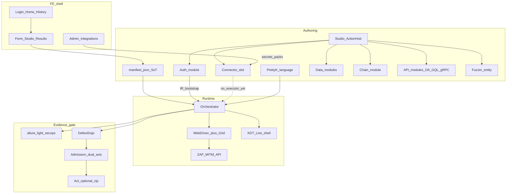
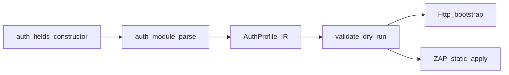
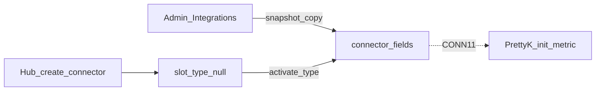

# MODULES-SKELETON — карта модулей под диаграммы

> Не badge `CANON`. Не техпаспорт целиком.  
> Скелет: узлы → рёбра → потом диаграммы / поочерёдные FRIEND-топики.  
> Search: `rg MODULES-SKELETON docs/canon/` · FRIEND: [`INDEX.md`](INDEX.md) · кандидаты: [`POSSIBLE-FRIEND.md`](POSSIBLE-FRIEND.md).  
> Slice: **11 августа 2026** (экстракт из EVIDENCE AUTH + CONN + runtime hub).

## Зачем

1. Боту — не читать эпики: вот граф продукта.  
2. Тебе — постепенно наполнять FRIEND **по одному модулю**.  
3. Потом — резать slide/diagram из узлов ниже (mermaid IDs стабильны).

---

## 1. Граф контура (скелет)



**Легенда ребра:** сплошная = lab as-built; пунктир = слот без runtime (honest-contract).

---

## 2. Узлы — статус наполнения

| mermaid id | Модуль (1 фраза) | Статус hub | Источник экстракта | След. шаг |
|---|---|---|---|---|
| `ManifestSoT` | JSON-манифест = machine SoT формы | **FRIEND** [`manifest-sot.md`](manifest-sot.md) | — | — |
| `runtime` блок | Grid ≠ Live ≠ Allure ≠ Dojo | **FRIEND** [`runtime-shell.md`](runtime-shell.md) | — | — |
| lab contour | lab_up обязательный vs opt-in | **FRIEND** [`lab-up.md`](lab-up.md) | — | — |
| `ZAP` | demon vs webswing; dual ports | **FRIEND** [`zap-dual.md`](zap-dual.md) | — | — |
| security | loopback / MITM / disablekey | **FRIEND** [`security-lab.md`](security-lab.md) | — | — |
| `Admit` / `ActPkg` | две оси; акт optional | **FRIEND** [`admission.md`](admission.md) | — | — |
| honest | слот ≠ runtime | **FRIEND** [`honest-contract.md`](honest-contract.md) | — | — |
| walls | Desktop Fuzzer / LSP / … | **FRIEND** [`walls.md`](walls.md) | — | — |
| discovery | АвтоАвторизоваться / label / heal | **FRIEND** [`discovery-heal.md`](discovery-heal.md) | DISC дно; HEAL §3 landed | не near |
| `AuthMod` | Studio Авторизация → IR → apply | **FRIEND** [`auth-module.md`](auth-module.md) | — | — |
| auth slots | legacy enum / bank gaps | **FRIEND** [`auth-slots.md`](auth-slots.md) | — | — |
| `ConnSlot` | Admin → activate → thin MethodId | **FRIEND** [`connectors.md`](connectors.md) | init/metrics/SSH/logs/MQ·DB | thick SQL/MQ later |
| `DataMod` | test_data_constructor → DataStream | **FRIEND** [`data-modules.md`](data-modules.md) | — | — |
| `PrettyK` | MethodId / `<!>` / `>?` | **FRIEND** [`prettyk-core.md`](prettyk-core.md) | — | — |
| `ChainMod` | глаголы Цепи / карта / ≠ чужой HAR | **FRIEND** [`chain.md`](chain.md) | — | — |
| `ApiMod` | OA/GQL/gRPC каскад ресурс→модуль→URL | **FRIEND** [`api-modules.md`](api-modules.md) | — | — |
| `FuzzerEnt` | ФаззингВолна / modes / corpus auto / observed opt-in | **FRIEND** [`dast-wave.md`](dast-wave.md) | — | — |
| `StudioHub` | единственный create | **FRIEND** [`studio-hub.md`](studio-hub.md) | — | — |
| `LoginHome` | Login→Home→History→Workspace | **FRIEND** [`fe-shell.md`](fe-shell.md) | — | — |
| `Workspace` | Form / Studio / Results | покрыт [`fe-shell.md`](fe-shell.md) + hub | — | не отдельный топик |
| History/NAV | CheckInstance registry | **FRIEND** [`nav-check.md`](nav-check.md) | — | — |
| `AdminInt` | секреты интеграций Admin | **FRIEND** [`admin-integrations.md`](admin-integrations.md) | — | — |
| `Orch` / WD / Live / Allure / Dojo | роли runtime | покрыт [`runtime-shell.md`](runtime-shell.md) | — | не плодить топики |
| Sonar dig / session FE | hygiene + UX notes | **EVIDENCE only** | history | не модуль продукта |

---

## 3. Экстракт AUTH (полезное зерно)

Не UX-кнопки. Модульный паспорт:

```text
Hub create-auth
  → module_type=Авторизация + auth_fields.constructor
  → parse → AuthProfile IR
  → validate/dry-run (без утечки секретов)
  → apply: Http bootstrap | static ZAP
```

| Тезис | Факт |
|---|---|
| Паттерн | как data-модули; **не** dual-write в `auth_details` |
| Static | `auth=bearer\|basic\|cookie\|header\|none` |
| Chain | `auth=chain` + `METHOD URL` + Header/Body + `Capture … as id` |
| Указатель | `active_auth_module` = id листа |
| Честность | unsupported → notes / `applied: false`; chain→ZAP = позже (AUTH-12) |
| Git якорь | `c71d638` → `dev` (lab) |

Отвергнуто: auth снова на анкету; фейковый applied.

---

## 4. Экстракт CONN (полезное зерно)

```text
Admin Integrations (URL/DSN/tokens/packs/lookback/query)
  → Studio Hub create-connector (слот без типа)
  → activate type → copy snapshot into connector_fields
  → PrettyK init + metric  (CONN-11, PoC low — пунктир)
```

| Тезис | Факт |
|---|---|
| Три слоя | доступ ≠ слот ≠ вызов |
| Studio | только activate + read-only snapshot + «Обновить из Admin» |
| Packs | только Admin `prom_metric_packs` → копия в слот |
| Иконка | brand leaf **после** активации типа |
| Runtime | **нет** executor |
| IAST | disabled в dropdown (не peer) |

Отвергнуто: толстая Studio-форма; packs в Редакторе; IAST как коннектор; «MethodId прямо сейчас».

---

## 5. Порядок наполнения / окультуривания

**Скелет §2 закрыт** — каждый узел графа имеет FRIEND или явное «покрыт X».

| Режим | Куда |
|---|---|
| Net-new модуль | [`POSSIBLE-FRIEND.md`](POSSIBLE-FRIEND.md) § новые |
| Утолстить тонкий FRIEND | backlog **CANON-CULT-1…5** · POSSIBLE-FRIEND `deepen-*` |
| Порядок CULT | data → admin → auth-slots → lab-up → security-lab |

Правило тела: тезисы компактно · mermaid id из §1 · EVIDENCE в INDEX (не копипаст dig).

---

## 6. Заготовки диаграмм (копипаст позже)

**AUTH apply**



**CONN activate**



**Допуск (уже FRIEND)** — см. [`admission.md`](admission.md); сюда не дублировать.

---

## 7. Не тащить в скелет модулей

| Шлак | Куда |
|---|---|
| Sonar Open Δ / extract helpers | EVIDENCE dig |
| Home 96×96 / тени / стрелки | fe-shell QUEUE / session EVIDENCE |
| Vite Job Object detach | global `secops-lab` (операционный) |
| Admin «5 фич» research без ship | backlog pulse |

---

## 8. Связь файлов

| Файл | Роль |
|---|---|
| Этот | скелет + экстракт + очередь наполнения |
| [`INDEX.md`](INDEX.md) | FRIEND registry + EVIDENCE links |
| [`POSSIBLE-FRIEND.md`](POSSIBLE-FRIEND.md) | очередь промоута |
| history `*-session-*` / `*-conn-*` | свидетельства сессий |
