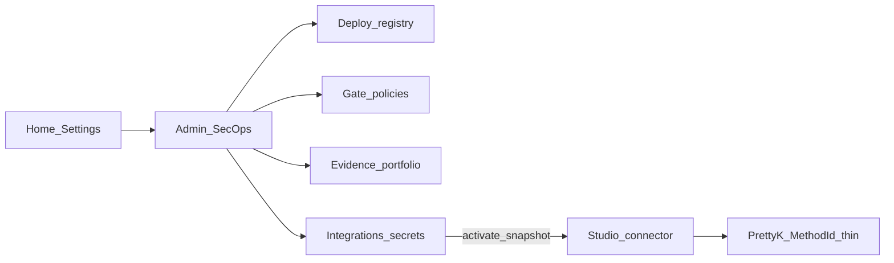

# Admin Integrations — секреты и доступы

> **CANON** — hub topic. Slice: **11 августа 2026** (CULT-2).  
> Слот Studio + thin MethodId: [`connectors.md`](connectors.md). Shell: [`fe-shell.md`](fe-shell.md).  
> As-built QUEUE: [`../internal/admin-secops.md`](../internal/admin-secops.md).  
> Реестр: [`INDEX.md`](INDEX.md).

## 1. Admin ≠ History ≠ Results ≠ Live

| Оболочка | Роль |
|---|---|
| **Admin** | портфель деплоев, политики допуска, evidence-агрегаты, **секреты интеграций** |
| **History** | реестр `CheckInstance` / runs ([`nav-check.md`](nav-check.md)) |
| **Results** | один прогон |
| **Live** | оперативный монитор + API evidence/hooks/gate |

## 2. Секции (скелет программы)

| Секция | Делает | Честность |
|---|---|---|
| Реестр / карточка деплоя | app/env/Gate tag / linked checks | lab localStorage + sync gates |
| Политики | пороги C/H, filter, retention, waivers → Live GatePolicy | QG-AF lab |
| Evidence | portfolio + trends | Live-first / showcase tag |
| **Интеграции** | URL/DSN/токены + Prom packs + SIEM/SSH/MQ | источник snapshot для Studio |
| Обзор | KPI программы | live derive (не vanity mock) |

## 3. Интеграции → Studio → thin call

1. Home «Настройки» → Admin; **не** History runs.  
2. Peer-типы доступа: Allure · Dojo · Prometheus · БД RO · SIEM/логи · SSH · MQ (IAST — не peer).  
3. Packs **только** Admin (`prom_metric_packs`) → копия в connector при activate.  
4. Studio после activate — read-only snapshot + «Обновить из Admin»; толстой формы секретов в Редакторе нет.  
5. PrettyK **thin MethodId** есть (init / Prom / SSH / logs / MQ·DB probe) — gates в [`connectors.md`](connectors.md); толстый SQL/MQ protocol — later.  
6. FE-auth lab ≠ секреты интеграций.  
7. Soft hold / package secrets — ops рычаги, не Admin-vault ([`honest-contract.md`](honest-contract.md)).

## 4. Residual QUEUE

Каталог полей по типу · airgap health probe · bank SSO на Admin · не тащить SOC MTTD в Overview. Detail KPI — [`admin-secops.md`](../internal/admin-secops.md).
