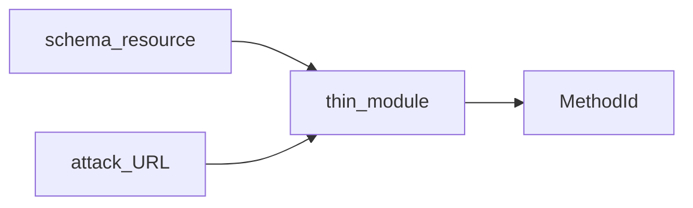

# API-модули — OpenAPI / GraphQL / gRPC

> **CANON** — hub topic. Slice: **11 августа 2026**.  
> Реестр: [`INDEX.md`](INDEX.md).  
> QUEUE/EVIDENCE: acceptance 13–17, 20–21 · [`../imp-api-modules-epic.md`](../imp-api-modules-epic.md).

## Тезис

Модули **OpenAPI / GraphQL / gRPC** — каскад:

**ресурс схемы → thin module → URL атаки (+ allowlist) → MethodId.**

Модуль — слот импорта, инвентаря и вызова. Это **не** сканер и не обещание silent active scan.

## Границы

| Делаем | Не делаем |
|---|---|
| Нормализованный inventory / parse | «Галочка = industrial API DAST» |
| Relative URL от цели атаки | Host-override на форме как SoT |
| Честные notes / opt-in на тяжёлые пути | Default live unary / AS без явного включения |
| Согласованный lab / стенд | Съём дна [`discovery-heal.md`](discovery-heal.md) |

## Не обещаем

- Silent active scan  
- Streaming / mTLS gRPC как канон «готово»  
- Что bank-suite = полевой акт приёмки без отдельного протокола  

Слот ≠ runtime: [`honest-contract.md`](honest-contract.md). Studio create: [`studio-hub.md`](studio-hub.md).
