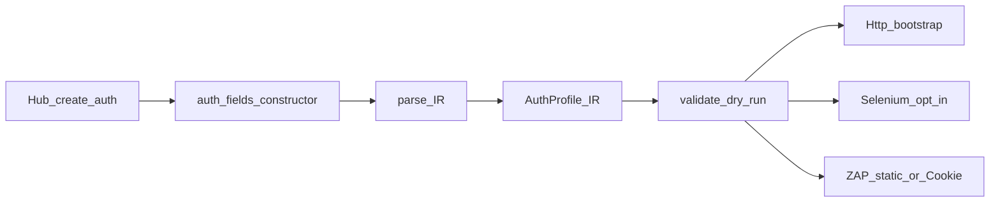

# Auth module — Studio Авторизация

> **CANON** — hub topic. Slice: **11 августа 2026** (зачисление lab 12–15+37).  
> Detail: [`../internal/auth-module.md`](../internal/auth-module.md) · matrix: [`../internal/auth-matrix.md`](../internal/auth-matrix.md).  
> EVIDENCE: acceptance [`30`](../acceptance/30-trials-auth12-apikey-2026-08-11.md)…[`37`](../acceptance/37-trials-auth-browser-zap-cookie-2026-08-11.md).  
> Реестр: [`INDEX.md`](INDEX.md). Честность: [`honest-contract.md`](honest-contract.md).  
> Слоты / gaps: [`auth-slots.md`](auth-slots.md).

## 1. Решение

Auth — модуль `module_type=Авторизация` в Studio (не поле анкеты `auth_type` как SoT authoring).

| Тезис | Факт |
|---|---|
| Паттерн | текст → IR → validate → apply |
| SoT canvas | `auth_fields.constructor` |
| **Не** | dual-write полотна в `auth_details` |
| Указатель | `active_auth_module` = id **или** CSV ids / `auth=compose` |
| Legacy | `auth_type` / `auth_details` — старые манифесты |

## 2. Диалекты (lab основа)

| Kind | Суть | Gate |
|---|---|---|
| **static** | `bearer\|basic\|cookie\|header\|apikey\|querykey\|none` | Http bootstrap |
| **chain** | HTTP call-chain + Capture → bearer | Http |
| **compose** | `modules=id1,id2` или CSV active | static ∪ chain ∪ form/action |
| **form** | Selenium login + locators `тип значение` | `KDT_AUTH_FORM_BROWSER=1` |
| **action** | form + MFA TOTP/SMS + `otp_locator` | тот же browser gate |

Browser cookies → Http jar **и** ZAP Replacer `Cookie` (acceptance 37).  
Query Key в ZAP — honest note (нет Replacer query).

## 3. Runtime / честность

1. Http bootstrap: active module → IR; multi → `apply_auth_profiles`; один success check в конце.  
2. Unsupported / bolvan без gate → `applied: false` + notes; dry-run не светит секреты.  
3. Discovery MethodId ≠ боевой auth-module ([`discovery-heal.md`](discovery-heal.md) — дно).  
4. Residual (не блок основы): deep SSO / script slots · industrial MFA farm — [`auth-slots.md`](auth-slots.md).

## 4. Банку

«С вас» учётки / URL входа / локаторы / TOTP secret или SMS code.  
Не обещаем Playwright MFA farm и снятие дна discovery без отдельного 2FA.
