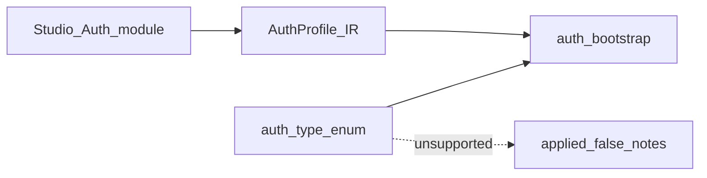

# Auth slots — legacy enum / bank gaps

> **CANON** — hub topic. Slice: **11 августа 2026** (зачисление lab 12–15+37).  
> Authoring / диалект: [`auth-module.md`](auth-module.md).  
> Полная таблица: [`../internal/auth-matrix.md`](../internal/auth-matrix.md).  
> Реестр: [`INDEX.md`](INDEX.md). Правило: [`honest-contract.md`](honest-contract.md).

## 1. Два мира

| Мир | Статус |
|---|---|
| Studio module + IR | lab authoring — [`auth-module.md`](auth-module.md) |
| `security_configuration.auth_type` | legacy / импорт; **срезан** с EntryPoint |
| Bank deep gaps | слот до отдельного заказа банка |

## 2. Ярусы

| Ярус | Примеры | Runtime |
|---|---|---|
| **Landed static** | none / basic / bearer / cookie / header / **apikey** / **querykey** | Http ✅; ZAP static через `ПрименитьAuth` (querykey — honest note) |
| **Landed compose / form / action** | `modules=` · form browser · action+MFA | Http + opt-in browser; residual harden — QUEUE |
| **△ helper** | page login substring / Auth Helper | notes; не «SSO платформа» |
| **Slot / bank later** | script Web/API · deep API SSO sequence · industrial MFA farm | `applied: false` + notes, пока банк не заказал |

## 3. Тезисы

1. Unsupported → `applied: false` + `notes[]`, не фейковый success.  
2. Http bootstrap (`KDT_AUTH_BOOTSTRAP` default on) ≠ авто-ZAP (`KDT_ZAP_AUTH_BOOTSTRAP` default off).  
3. API Key / Query Key / form / action — **не** «слот AUTH-12»: lab основа зачислена; residual UI/harden — QUEUE.  
4. Не добрить enum «для красоты» без банка.  
5. Детали keys/env/тесты — только [`auth-matrix.md`](../internal/auth-matrix.md).

## 4. Окультурить

Matrix ↔ module IR в один операторский паспорт; deep SSO / script — по боли банка. Residual: Studio locator UI C · compose/CSV docs sync.
