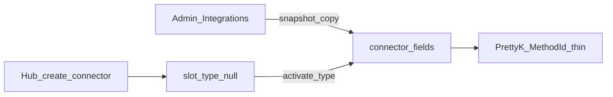

# Connectors — Admin / Studio activate / thin MethodId

> **CANON** — hub topic. Slice: **11 августа 2026** (зачисление CONN-11…13).  
> Detail: [`../internal/connectors.md`](../internal/connectors.md).  
> Admin слой: [`admin-integrations.md`](admin-integrations.md).  
> EVIDENCE: [`../history/2026-08-11-conn-admin-activate/`](../history/2026-08-11-conn-admin-activate/) · acceptance 27–28 / 31–33.  
> Реестр: [`INDEX.md`](INDEX.md). Честность: [`honest-contract.md`](honest-contract.md).

## 1. Три слоя

| Слой | Делает | Не делает |
|---|---|---|
| **Admin → Интеграции** | URL/DSN/токены, Prom lookback/**packs**, SIEM query/window, SSH/MQ | шаги сценария |
| **Studio слот** | создать, **активировать тип**, snapshot, «Обновить из Admin» | packs/lookback/query authoring |
| **PrettyK thin** | MethodId init / метрики / SSH / логи / MQ·DB probe | толстый SQL/MQ protocol runtime |

## 2. Thin MethodId (lab основа)

| MethodId | Суть | Gate |
|---|---|---|
| `ИнициализироватьКоннектор` | bind слота | — |
| `ЗапроситьМетрикиКоннектора` | Prom pack | live Prom URL |
| `ВыполнитьКомандуSSH` | remote cmd | SSH creds |
| `ЗапроситьЛогиКоннектора` | SIEM/logs query | `KDT_CONNECTOR_LOGS=1` |
| `ПроверитьОчередьКоннектора` | MQ TCP/topic probe | MQ env |
| `ПроверитьБазуКоннектора` | DB TCP/RO probe | DB env |

After-fuzz meta может дернуть probe по типу коннектора (Prom / logs / MQ / DB) — ops, не «IAST платформа».

## 3. Тезисы

1. Доступ ≠ слот ≠ вызов.  
2. До активации типа — нейтральный leaf; brand — после activate.  
3. Packs только Admin (`prom_metric_packs`) → копия в `connector_fields.metric_packs`.  
4. Thin MethodId **есть**; толстый executor (полный SQL dialect / MQ protocol / RF-BRIDGE) — QUEUE evolve.  
5. IAST в dropdown — disabled (агент ≠ коннектор).  
6. Типы peer: БД RO · Журналы/SIEM · Prometheus · SSH · Очередь.

## 4. Отвергнуто

Толстая Studio-форма; packs в Редакторе; IAST как peer; возвращать dual Admin+Studio config; врать «industrial AS завтра».
