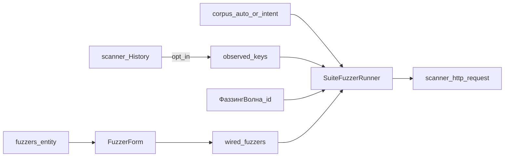

# DAST wave — ФаззингВолна

> **CANON** — hub topic. Slice: **12 августа 2026** (словари + observed feed).  
> Narrative/lab: [`../dast-fuzzing.md`](../dast-fuzzing.md) · howto: [`../fuzz-howto.md`](../fuzz-howto.md).  
> Стены: [`walls.md`](walls.md) (нет Desktop Fuzzer / Jython / SecLists dump).  
> Реестр: [`INDEX.md`](INDEX.md).  
> Inbox landed: [словари](../canon-requests/2026-08-11-fuzz-dictionaries-defaults.md) · [observed feed](../canon-requests/2026-08-12-observed-feed-dast-wave.md).

## 1. Контур

| Слой | Факт |
|---|---|
| SoT | `test_suites.fuzzers[]` |
| Authoring | Studio Fuzzer: targets, corpus, `algorithm`, policy, session_replay |
| Корпус | KDT pack `intent_*`; `corpus=auto` / пусто → resolve по location |
| Targets | Явные в entity; опционально merge observed keys из History (runtime opt-in) |
| Запуск | PrettyK `ФаззингВолна <fuzzer_id>` → Python runner → scanner Daemon HTTP |
| Маски | `{MASK}` / `{MASK_n}`; TAB в корпусе → слоты |
| Session | History Cookie/Authorization; иначе `session_missing` / `session_lost` |
| Лимиты lab | `max_requests` ≤ 25, RPS ≤ 1 |

## 2. Режимы (lab closed Phase 2)

| Режим | Смысл |
|---|---|
| sniper | одна ось / цель |
| pitchfork | zip по индексу (внутри цели `a,b` или across `targets[]`) |
| cluster_bomb | матрица с hard cap |

Задание без нового SoT-поля: `algorithm` ∈ эти режимы (legacy `triples` → sniper). Отдельное поле `wave_mode` в манифест — только по приказу.

## 3. Корпус

1. Продукт возит **свои** кураторские `intent_*` (имя, версия, cap строк в pack). Чужой dump в git — нет ([`walls`](walls.md) § SecLists).  
2. **`corpus=auto`** (или пусто) — матрица location → default corpus в runtime; не «ИИ» и не размер файла.  
3. Явный `intent_*` / resource всегда побеждает auto.  
4. Типичный путь authoring — auto; именованный pack — когда нужен узкий удар.  
5. Slot в схеме ≠ «банк принял corpus»; lab `max_requests` остаётся.

## 4. Targets и observed feed

1. Конфиг волны (режимы, corpus, policy) — в Fuzzer entity; feed **не** заменяет entity и **не** поле SoT.  
2. **Observed** — ключи, уже видимые в History (lab: query + top-level JSON scalars); merge в targets только при opt-in (`KDT_TRAFFIC_INSERTION_FEED` и код runner).  
3. Пустой History / feed off → поведение как без feed; не spider и не «полный охват».  
4. **Не смешивать:** observed ≠ active guess (Param Miner-класс) ≠ карта подмен Цепи (`slots[]`).  
5. **`corpus=auto` ≠ observed feed:** первое выбирает pack; второе — список дыр.

Path / cookie / header harvest, guess runtime, schema fuzz — QUEUE / evolve, не этот slice.

## 5. Роль scanner

Волна ходит в цель через **scanner Daemon** (прокси / History / HTTP API).  
**ФаззингВолна** — runner + pack + policy KDT, не имитация Desktop Fuzzer и не обещание «scanner Active Scan умнее нашего контура».  
Пассивный скан и прочие опции scanner — соседние рычаги lab; их наличие ≠ мозг этой волны. Сравнивать режимы и knobs — норма; ставка продукта волны — самописный контур.

## 6. Честность

1. Runtime anomalies — по коду (`scanner_alert`, `reflection`, `*_outlier`, …); narrative vs имена — не раздувать.  
2. Slot в схеме ≠ «банк принял corpus».  
3. Не имитировать scanner Desktop Fuzzer API.  
4. Не врать «готово» про guess, path/cookie harvest, SecLists в репо.
