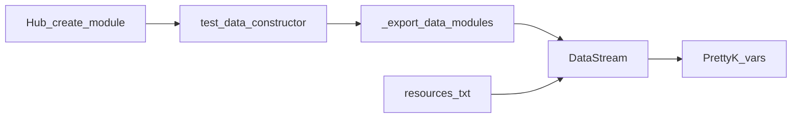

# Data modules — поток данных

> **CANON** — hub topic. Slice: **11 августа 2026** (CULT-1).  
> Narrative: [`../wired.md`](../wired.md) § модули / resources.  
> Create: [`studio-hub.md`](studio-hub.md) (`create-module`).  
> Не путать с: [`connectors.md`](connectors.md) · [`auth-module.md`](auth-module.md) · [`dast-wave.md`](dast-wave.md).  
> Реестр: [`INDEX.md`](INDEX.md). Код: `Controller._export_data_modules`.

## 1. Роль

| Это | Не это |
|---|---|
| Источники / преобразования → `DataStream` → `${id}` | Коннектор (Admin + thin MethodId) |
| `module_type` данные | `Авторизация` / `Коннектор` / fuzzer entity |
| Resources `.txt` в stream | dual-write секретов на анкету |

## 2. Контур export (lab as-built)

| Вход | Условие | Результат в stream |
|---|---|---|
| `data_storage_fields` | `source_type=Генерация из источника` + `process_id=additional_urls` | `list[str]` path/URL; relative ← `base_url_override` |
| `constructor` / `editor` | properties-модуль | apply properties → ключи |
| то же | URL line-list (G-65) | `list[str]` + пометка url-list |
| то же | PrettyK `Пусть ${id} = …` | значение после apply context |
| иначе | нет `${id}` после apply | **WiredError** (не тихий skip) |

1. SoT список: `test_suites.test_data_constructor[]`; create через Hub.  
2. Export только `_DATA_EXPORT_MODULE_TYPES`; auth/conn/fuzz — **не** сюда.  
3. Resources: `data_file` / `fuzz_corpus` (`.txt`); `scenario_json` — reserved/reject.  
4. Старый `module_type: "Фаззер"` — только импорт; новые → [`dast-wave.md`](dast-wave.md).  
5. Lab: `${data_module}` → `ОбойтиСтраницы` / `ДляКаждого` / `Размер`.  
6. Коллизия `${id}` в stream → ошибка.

## 3. Честность

| Состояние | Формулировка |
|---|---|
| `additional_urls` + известный process | «Работает» (есть тесты export) |
| неизвестный `process_id` / `source_type` | слот или WiredError — не «готово» |
| UI без export-ветки | authoring only ([`honest-contract.md`](honest-contract.md)) |

Residual QUEUE (не блок основы): полный каталог `source_type`/`process_id` · FE↔runtime parity checklist · bank examples.
