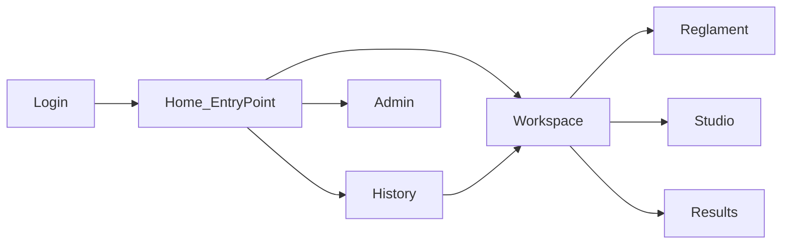

# FE shell — Login / Home / ЖЦ

> **CANON** — hub topic. Slice: **11 августа 2026**.  
> QUEUE detail: [`../e2e-shell-epic.md`](../e2e-shell-epic.md) · chrome: [`../internal/fe-shell-chrome.md`](../internal/fe-shell-chrome.md).  
> NAV: [`nav-check.md`](nav-check.md). Реестр: [`INDEX.md`](INDEX.md).

## 1. Контур экранов

| Экран | Роль |
|---|---|
| Login | FE-auth lab (`admin`/`debug`); SSO muted |
| Home | Entry: История / Новая проверка / Настройки |
| History | реестр NAV |
| Admin | политики / evidence / интеграции — не реестр runs |
| Workspace | Форма → Редактор → Результаты |

## 2. Тезисы

1. Dark default. Без react-router: `sessionStorage` screen + user.  
2. Brand (SecOps / PrettyK) middle-click / Ctrl+click → home без dirty-диалога; ЛКМ — guard.  
3. Ctrl+S = save entity; Ctrl+K = command palette (capture KeyK).  
4. FE-auth ≠ Selenium/Grid session ([`runtime-shell.md`](runtime-shell.md)).  
5. Allure / Dojo / Live **не** подменяются shell.

## 3. Честность

Серверная auth / Blitz SSO — open (E2E-AUTH). Lab учётки — только стенд.
