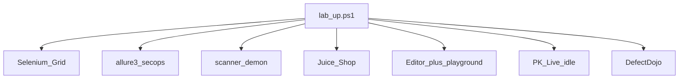

# Lab-up — обязательный контур

> **CANON** — hub topic. Slice: **24 сентября 2026** (2FA sealed: DefectDojo — обязательный контур).  
> PUBLIC команды: [`../stand.md`](../stand.md) · шпаргалка: [`../operator-cheatsheet.md`](../operator-cheatsheet.md).  
> Roles: [`runtime-shell.md`](runtime-shell.md). scanner: [`scanner-dual.md`](scanner-dual.md). Bounds: [`security-lab.md`](security-lab.md).  
> Реестр: [`INDEX.md`](INDEX.md). Skill: global **`prettyk-lab`**.

## 1. Обязательное vs opt-in

| Входит в `lab_up` | Не входит |
|---|---|
| Grid + ноды | Webswing (отдельный up) |
| allure3-secops (канон) · DefectDojo (обязателен) | api-lab — opt-in |
| scanner **demon** | prod / VPS |
| Juice Shop | чистка Juice mid-run без просьбы |
| Editor + playground + Live idle | — |

## 2. Пульты + ready (после «подними»)

| Имя | URL (lab) | Ready smoke |
|---|---|---|
| allure3-secops | `http://127.0.0.1:5050/` | `/health` → service `allure3-secops` |
| DefectDojo | `http://127.0.0.1:8081/` | `/login` 200 |
| PrettyK Live | `http://127.0.0.1:8767/` | `/api/meta` |
| Editor | `http://localhost:5173/` | HTML shell (не белый экран) |
| scanner demon API | `http://127.0.0.1:8080/` | `/JSON/core/view/version/` |

## 3. Тезисы ops

1. Старт: `orchestrator/tools/lab_up.ps1`; перед прогоном часто `lab_clean.ps1 -Target allure,live` (`allure` ≡ allure3-secops).  
2. Запрещены имена: Allure Lite / frankescobar / allure-docker-service как продукт.  
3. Live idle не гасить «заодно»; clean Live: diary/meta/`results_hooks.json`, процесс жив.  
4. FE: Python API playground → ensure/restart; только UI → HMR; мёртвый `:5173` → ensure.  
5. Shell abort Cursor ≠ смерть Vite/Live ([`stand-shell-abort`](../../.opencode/rules/stand-shell-abort.mdc)).  
6. Artifacts: soft `legal_hold` / package secrets gate — ops рычаги ([`nav-check.md`](nav-check.md) · cheatsheet); не prod SLA.

## 4. Честность

Это **lab**, не SLA банка. DefectDojo — обязательный контур стенда; api-lab — opt-in флаг (без него не врать «весь контур вверх»).
