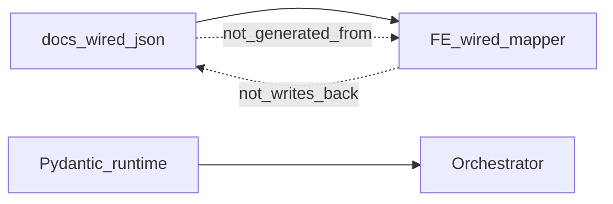

# Манифест — machine контракт проверки

> **CANON** — hub topic. Slice: **13 августа 2026** (vnext: форма = прямой маппер, не JSON Schema).  
> JSON: [`../wired.json`](../wired.json). Narrative: [`../wired.md`](../wired.md).  
> Rule: [`schema-sot`](../../.opencode/rules/schema-sot.mdc). Реестр: [`INDEX.md`](INDEX.md).

## 1. Роли

| Слой | Роль |
|---|---|
| **`docs/wired.json`** | machine-контракт проверки (в vnext — не генератор формы) |
| **FE маппер** (`WiredForm.tsx`) | прямой React-рендер wired → UI (без JSON Schema) |
| **Pydantic** (`orchestrator/models/wired.py`) | контракт **исполнения**, не генератор анкеты |
| **Legacy fields в Pydantic** | импорт старых JSON — не повод писать обратно в манифест |

## 2. Тезисы

1. Менять JSON-манифест — только по явной воле владельца.  
2. При расхождении код/docs/UI ↔ манифест — **перестраивать от JSON**, не наоборот.  
3. Чего нет в манифесте — можно резать в runtime/docs; **нельзя** возвращать в манифест без приказа.  
4. Порядок смены поля: манифест (если разрешили) → при нужде Pydantic → тесты → `wired.md` → FE маппер.
5. Форма рендерится прямым маппером из runtime-контракта, не из JSON Schema.

## 3. Граница с hub

Создание сущностей в UI — [`studio-hub.md`](studio-hub.md); содержимое конструкторов — PrettyK / auth / conn / wave. Этот топик — **только** граница runtime-контракта манифеста.
