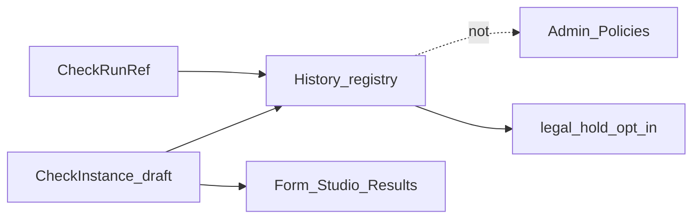

# NAV — CheckInstance и реестр

> **CANON** — hub topic. Slice: **11 августа 2026** (hold ops).  
> QUEUE detail: [`../nav-check-epic.md`](../nav-check-epic.md).  
> Честность: [`honest-contract.md`](honest-contract.md). Реестр: [`INDEX.md`](INDEX.md).

## 1. Сущности

| Сущность | Смысл |
|---|---|
| **CheckInstance** (draft/definition) | Конфиг проверки; живёт без execute |
| **CheckRunRef** | Один запуск + статус |
| **History** | Реестр проверок (черновики + runs) |
| **Policies / Admin** | Орг-гейты — **не** список прогонов |
| **legal_hold** | Soft hold на check в artifact index; opt-in |

## 2. Тезисы

1. Close editor ≠ close instance; dirty → Save / Discard / Stay.  
2. Hash SPA: `#/home` · `#/history` · `#/checks/:id/:view` (form|studio|results).  
3. Persist lab: `localStorage` + file-bus `/api/checks` — **не** multi-tenant / SSO registry.  
4. Вход из History → всегда **Регламент** (form), не «последняя вкладка».  
5. Policies ≠ runs (Home «Настройки» → Admin, не History).  
6. **Hold:** `POST /api/artifacts/hold` · CLI `--hold` / `--release-hold` · badge в History · retention/purge **пропускают** held (`held_skipped`). Default off.  
7. KDT hold ≠ банковский WORM / compliance vault ([`honest-contract.md`](honest-contract.md)).

## 3. Не врать

Bank multi-user persist / server auth registry / «мы ваш legal archive» — этап N или стена. Lab landed ≠ промышленный registry.
