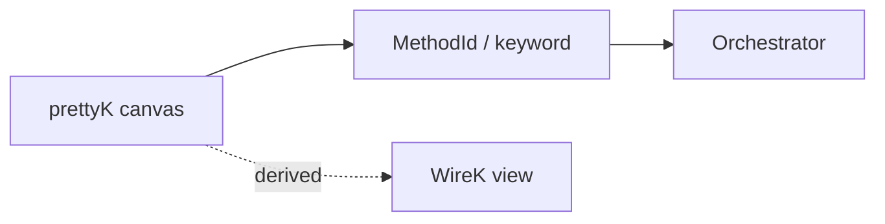

# prettyK — DSL & Brand Identity

> **CANON** — hub topic. Slice: **20 августа 2026** (2FA sealed: English canon, polymorphic syntax, DSL↔brand dual identity, lowercase `p` — Вера).
> Реестр: [`INDEX.md`](INDEX.md). Бренд: [`brand-strategy.md`](brand-strategy.md).

## 1. Двойная природа: DSL и бренд

**prettyK** — одновременно имя предметно-ориентированного языка (DSL) и мастербренд платформы. Строчная `p` — эстетически и технически канонична для цифровой среды. Вера, 20 авг 2026.

| Контекст | Значение |
|---|---|
| **DSL** | Декларативный язык описания проверок безопасности. Одна строка ≈ одно действие. |
| **Бренд** | Мастербренд: prettyK SecOps Studio, prettyK SecOps Lab, prettyK Control, prettyK Hub, prettyK Report, prettyK LIVE. |

## 2. Полиморфный синтаксис

prettyK поддерживает несколько человеческих языков для ключевых слов. Surface syntax разный — один и тот же MethodId под капотом.

```
Русский:      Нажать css ".login-btn"
Английский:   Click css ".login-btn"
Испанский:    HacerClic css ".login-btn"
                ↓
         MethodId: webdriver|click
                ↓
         Orchestrator (один wire)
```

**Правило:** любое ключевое слово на любом поддерживаемом языке резолвится в тот же MethodId. Оркестратор не знает на каком языке написан сценарий.

### Канон языков

| Язык | Статус | Примечание |
|---|---|---|
| **English** | **Canon** | Основной. Документация, примеры, keywords.json — английские имена первичны. |
| **Russian** | Supported locale | Текущий рабочий. Остаётся как alias для всех keywords. |
| **Spanish** | Future | Архитектурно поддержано. Достаточно перевести keywords-файл. |

**English canon:** все новые keywords получают английское имя первым. Русское — alias. Monaco-автодополнение по умолчанию на английском; русское включается флагом/настройкой.

## 3. Железо (синтаксис)

| Тезис | Факт |
|---|---|
| Локаторы | `id` / `css` / `xpath` / `name` (+ кавычки при пробелах) |
| Переменные | `$name` / `${path}`; `Let`; не живут между сценариями автоматом |
| Условия / циклы | `If` / `Loop` / `ForEach` / `While` |
| Scenario failsafe | префикс первой строки canvas: `<!>` → допустимый отказ; без него hard-fail → admission VOID |
| Action soft | суффикс `>?` на шаге — ошибка в лог, сценарий жив |
| Heal label hint | суффикс `>#текст` — hint для locator heal (нужен soft / `PK_LOCATOR_HEAL`) |
| Label discovery | `Click > Login` / `Type > Label value` |
| GatherInfo | обход URL + spider (default BrowseThenSpider) |
| Конструктор UI | **32** видимые строки canvas (pad) — rule `constructor-30-lines` |
| Fuzzing wave | `FuzzingWave <id>` — см. [`dast-wave.md`](dast-wave.md) |

## 4. Архитектура



- **prettyK** — authoring canvas. Текстовый язык шагов в Редакторе.
- **WireK** — производное представление (не SoT authoring). Низкоуровневый wire-дамп.
- **Validate** (playground `:8765`) ≠ **Run** (Controller).
- **English canon:** `Click`, `OpenByURL`, `Type`, `If`, `ForEach` — первичны. Русские `Нажать`, `ОткрытьПоURL`, `ВставитьТекст`, `Если`, `ДляКаждого` — alias.

## 5. Не смешивать

| Это | Не это |
|---|---|
| prettyK authoring | полный language workbench (future-plans) |
| `<!>` сценария | `>?` шага |
| WireK | второй редактируемый SoT |
| Discovery/heal | [`discovery-heal.md`](discovery-heal.md) |
| English canon | удаление русского — русский остаётся alias |

## 6. Связь с брендом

Мастербренд **prettyK** (Pretty<) и DSL **prettyK** — одна сущность в разных контекстах. Полный бренд-канон: [`brand-strategy.md`](brand-strategy.md). Шеврон `<` — одновременно знак бренда и терминальный символ DSL (lettermark).