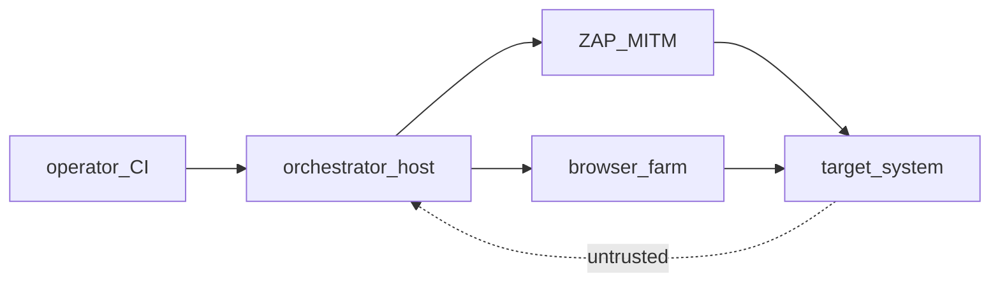

# Security lab — границы стенда

> **CANON** — hub topic. Slice: **11 августа 2026** (CULT-5).  
> PUBLIC detail: [`../security.md`](../security.md). Contour: [`lab-up.md`](lab-up.md).  
> Roles: [`runtime-shell.md`](runtime-shell.md). Реестр: [`INDEX.md`](INDEX.md).  
> Стены: [`walls.md`](walls.md) · честность: [`honest-contract.md`](honest-contract.md).

## 1. Модель доверия

Доверенные: оператор/CI, проверенный манифест, хост оркестратора, секреты env, выделенный Docker, закреплённые образы.  
Недоверенные: цель и ответы, данные ZAP, внешние манифесты, lab credentials, отчёты до классификации.

Lab compose — **демо**, не hardened prod.

## 2. Критические границы (сводка)

| Зона | Lab факт | Нельзя |
|---|---|---|
| ZAP API | часто `api.disablekey` + широкий addrs | публиковать `:8080` / proxy / Webswing наружу |
| Grid / noVNC | `:4444`, `:7900`/`:7901` | общая сеть; **docker.sock в ферму** |
| MITM | `acceptInsecureCerts` | ставить CA ZAP в corp trust / гонять личные секреты |
| Dojo lab | admin/admin, HTTP, `latest` | реестр реальных findings банка |
| Playground | `127.0.0.1:8765`, CORS `*` | слушать `0.0.0.0` без auth |
| Домены | `allowed_extra_domains` декларация | считать ACL сети ZAP |
| Artifacts | soft hold + package plaintext gate | обещать WORM / DLP банку |

## 3. Секреты (слои)

1. Маскирование в логах/Live/Allure известных plaintext.  
2. `pk:enc:v1:…` + `PK_MANIFEST_KEY` (не в git).  
3. `${ENV:VAR}` / `secretref:VAR` при загрузке.  
4. Authoring draft в `localStorage` — не место для prod-секретов.  
5. Package zip: refuse high-confidence plaintext; escape `PK_PACKAGE_ALLOW_SECRETS=1`.  
6. MITM всё равно видит трафик — маска логов ≠ политика стенда.

## 4. Scope до прогона

Владелец цели · домены/IP · виды scan · окно нагрузки · учётки · kill-switch · хранение результатов.  
Juice / цели — локально или выделенная lab-сеть. Чужой манифест без ревью — не гонять.

## 5. Industrial

Профиль `docker-compose.zap.industrial.yml` (API key, addrs) — **не** lab-default и не «мы уже prod».  
Полный текст границ — [`../security.md`](../security.md).
