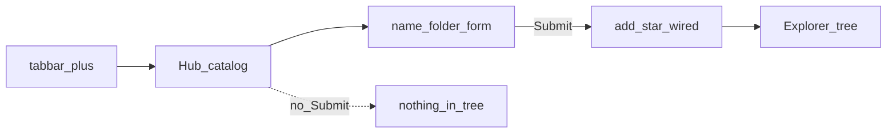

# Studio Action Hub — единственный create

> **CANON** — hub topic. Slice: **11 августа 2026**.  
> QUEUE detail / плитки / тесты: [`../studio-action-hub.md`](../studio-action-hub.md).  
> Auth create: [`auth-module.md`](auth-module.md). Conn create: [`connectors.md`](connectors.md).  
> Реестр: [`INDEX.md`](INDEX.md).

## 1. Роль

Action Hub — **единственная** осознанная точка создания сущностей из центральной панели Редактора (не из контекстного меню Explorer).

## 2. Тезисы

1. Без валидного **Submit** в дереве ничего не появляется; закрытие пустой вкладки = отмена черновика.  
2. Черновик `action-hub` в `openTabs`, **не** рисуется в таббаре; `+` = каталог.  
3. Имя на Submit обязательно (trim); дубликат / ошибка → форма жива, манифест не трогаем.  
4. Page/scenario + группа → `moveEditorFolderMember` после `add*`.  
5. Validate playground ≠ run Controller; Hub create ≠ execute.  
6. SecOps Monitor → Live `:8767`, **не** Allure `:5050`.  
7. Stub-плитки (results / external) — muted, без сущности.

## 3. Не ломать без приказа

Submit / группы / вкладки / порядок плиток — контракт as-built. `flexlayout` для editor tabs — запрещён.
