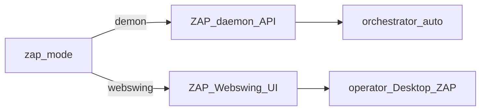

# ZAP — demon vs Webswing

> **CANON** — hub topic. Slice: **11 августа 2026**.  
> Lab detail / порты / скрипты: [`../webswing-daemon-stand.md`](../webswing-daemon-stand.md).  
> Contour: [`lab-up.md`](lab-up.md). Roles: [`runtime-shell.md`](runtime-shell.md).  
> Реестр: [`INDEX.md`](INDEX.md).

## 1. Два режима

| Режим | Зачем | Дефолт lab |
|---|---|---|
| **demon** (`zap_mode=demon`) | API для автоматики / волны | **да** — `lab_up` |
| **webswing** | Desktop ZAP в браузере (Sites/History/AS) | **нет** — opt-in |

## 2. Тезисы

1. Webswing **не** часть обязательного `lab_up`; поднимать `zap-webswing-up.ps1` или явный `zap_mode=webswing`.  
2. Dual-stand: demon API + Webswing API/UI одновременно — порты **разведены** (не гасить demon из‑за `:8080`).  
3. Lab якоря (пример): demon API `:8080` / proxy `:8099`; Webswing UI `:8082` / API `:8090` / proxy `:8199`.  
4. В пультах URL Webswing давать всегда; если контейнер down — пометить, не врать «жив».  
5. ZAP ≠ браузерная ферма ([`runtime-shell.md`](runtime-shell.md)).

## 3. Не смешивать

Allure / Live / Grid — другие роли. Ручной Desktop ZAP не заменяет demon для CI-автоматики.
