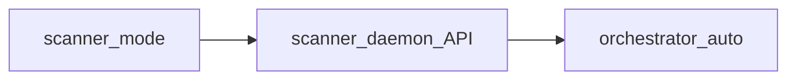

# scanner — demon

> **CANON** — hub topic. Slice: **22 августа 2026** (Webswing выпилен).  
> Lab detail / порты / скрипты: [`lab-up.md`](lab-up.md) · [`runtime-shell.md`](runtime-shell.md).  
> Реестр: [`INDEX.md`](INDEX.md).

## 1. Единственный режим

| Режим | Зачем | Дефолт lab |
|---|---|---|
| **demon** (`scanner_mode=demon`) | API для автоматики / волны / фаззинга | **да** — `lab_up` |

## 2. Тезисы

1. scanner работает как демон — API на `:8080`, MITM-прокси на `:8099`.  
2. Никакого GUI. PrettyK Live + Allure + Dojo закрывают мониторинг.  
3. scanner ≠ браузерная ферма ([`runtime-shell.md`](runtime-shell.md)).  
4. Контракт wired: `scanner_mode` — только `"demon"`. Webswing удалён 2026-08-22.

## 3. Почему Webswing убран

- scanner GUI в браузере — рудимент эпохи Selenium  
- PrettyK Live + diary + Allure-отчёт покрывают весь мониторинг  
- `:8082`, `:8090`, `:8199` — лишние порты и контейнер  
- Упрощает стенд: меньше compose-файлов, меньше bootstrap-кода, меньше документации  
(End of file)